<p align="center">
  
</p>

# 🔐 Awesome Cryptography & Encryption

<p align="center">
  <a href="https://github.com/ishandutta2007/Awesome-Awesome-Awesome"></a>
  <a href="https://discord.gg/jc4xtF58Ve"></a>
  <a href="https://github.com/ishandutta2007/Awesome-Cryptography-Encryption/stargazers"></a>
  <a href="https://github.com/ishandutta2007/Awesome-Cryptography-Encryption/network/members"></a>
  <a href="https://github.com/ishandutta2007/Awesome-Cryptography-Encryption/blob/main/LICENSE"></a>
  <a href="https://github.com/ishandutta2007"></a>
</p>

> 🛡️ **A curated collection of industry-leading SaaS platforms and open-source projects for Modern Cryptography, Public Key Infrastructure (PKI), Key & Secrets Orchestration, and Post-Quantum Cryptography (PQC) Readiness.**

---

## 📌 Executive Summary

Modern enterprise security architectures require robust cryptographic agility, rigorous key lifecycle governance, and forward-looking post-quantum cryptographic (PQC) migration strategies. This repository catalogs both enterprise SaaS powerhouses and open-source foundations powering zero-trust encryption, automated certificate management (ACME/CLM), hardware security module (HSM) integrations, and NIST FIPS-standardized algorithms (ML-KEM, ML-DSA, SLH-DSA).

---

## 📑 Table of Contents

- [📊 Sector Overview & Market Dynamics](#-sector-overview--market-dynamics)
- [☁️ SaaS / Hosted Platforms](#️-saas--hosted-platforms)
- [🔓 Open-Source GitHub Projects](#-open-source-github-projects)
- [🏗️ Architectural Frameworks](#️-architectural-frameworks)
- [🤝 How to Contribute](#-how-to-contribute)
- [⚖️ Disclaimer & Security Guidance](#️-disclaimer--security-guidance)
- [⭐ Star History](#-star-history)
- [💖 Support & Sponsorship](#-support--sponsorship)

---

## 📊 Sector Overview & Market Dynamics

The global enterprise key management and cryptographic data protection market is currently valued between **$3.0 billion and $3.5 billion**, projected to exceed **$9.5 billion by 2030** at a rapid compound annual growth rate (CAGR) of **~20%**. 

The sector exhibits a distinct structural duality:
* **Enterprise Consolidation at the Top:** Core enterprise contracts are moderately concentrated among cybersecurity incumbents—notably **Thales (CipherTrust)**, **CyberArk (including Venafi)**, **IBM / HashiCorp**, and **DigiCert**.
* **Underlying Architectural Fragmentation:** The operational layer remains highly fragmented across hybrid/multi-cloud key orchestration, automated certificate lifecycle management (CLM), non-human machine identity governance, and the emerging transition to **Post-Quantum Cryptography (PQC)** standards (NIST FIPS 203, 204, and 205).

---

## ☁️ SaaS / Hosted Platforms

Enterprises requiring commercial SLAs, high-assurance FIPS 140-2/3 Level 3 compliance, managed cloud orchestration, and global support rely heavily on dedicated SaaS solutions.

*The table below ranks major SaaS platforms by company valuation/market cap in descending order:*

| 🏢 Platform | 💰 Valuation / Company Size | 🏷️ Pricing | 🎁 Free Tier / Trial Limits | 📝 Description & Features |
| :--- | :--- | :--- | :--- | :--- |
| **[Thales CipherTrust](https://cpl.thalesgroup.com/)** | ~$48B–$50B Market Cap (Thales Group) / €18.4B+ Rev | From €165/mo (CTE Cloud) up to €3,310/mo (CDSPaaS / Cloud Key Mgmt) | Free-forever Community Edition (equiv. k170v virtual appliance, up to 4 CPUs, bundled with up to 3 CTE-K8s / DPG licenses); 30-day cloud / 90-day virtual appliance trials | 🛡️ **Enterprise key management & data protection platform**. Features centralized key lifecycle, HSM integration, database encryption, and multi-cloud key orchestration. The enterprise benchmark for regulated industries requiring FIPS 140-2 Level 3 validated HSMs. |
| **[HashiCorp Vault (HCP)](https://www.hashicorp.com/products/vault)** | $35B+ (IBM Cloud Software) / $6.4B Acquisition | From ~$0.03/hr (~$22/mo) for Dev tier; Essentials from $1.58/hr + $72.92/client/mo | $500 free trial platform credits (valid up to 6 months for 1 cluster); Development tier supports free sandbox deployment capped at max 25 active clients/mo | 🔑 **Managed secrets management & PKI platform**. Features dynamic secrets, transit engine for encryption-as-a-service, PKI secrets engine for internal CA, and automated ACME protocol support. The most widely deployed secrets management platform. |
| **[CyberArk](https://www.cyberark.com/)** | ~$20.6B Valuation / $1.36B Annual Revenue | From ~$1,800 to $2,400/privileged user/yr (Standard tier, min commit) | No public self-service free tier; 30-day guided evaluation / test sandbox provided via enterprise sales engagement (open-source Conjur OSS available for self-hosting) | 🚪 **Privileged access & machine secrets management**. Features Conjur for machine identity, automated credential rotation, and centralized policy enforcement across hybrid clouds. |
| **[DigiCert](https://www.digicert.com/)** | ~$8.0B Valuation (Clearlake / TA Associates) / ~$1B+ Rev | From $399/yr (Secure Site OV); Trust Lifecycle Manager baseline starts at ~$7,500–$8,000/yr (per seat/domain tier) | 30-day free trial for TLS/SSL certificates; interactive self-guided sandbox in DigiCert Demo Center (enterprise PoC upon request) | 📜 **Certificate lifecycle management (CLM)** with strong PQC research track record and deep CA integration. DigiCert Trust Lifecycle Manager provides discovery, automation, and governance. |
| **[RSA Security](https://www.rsa.com/)** | ~$2.1B Acquisition Valuation (STG) / ~$460M+ Rev | From $3.00 to $5.50/user/mo ($36–$66/user/yr for RSA ID Plus E1/E2 tiers) | 45-day free trial of RSA ID Plus (cloud MFA, single sign-on, and passwordless authentication testbed) | 🔐 **Identity and access security** with RSA SecurID for MFA, adaptive access policies, and RSA Archer governance risk & compliance. |
| **[Venafi (CyberArk)](https://www.venafi.com/)** | $1.54B Acquisition Valuation (CyberArk) / ~$150M+ ARR | From ~$12,500/yr (TLS Protect Cloud base packs, scaling per managed machine identity) | 30-day free trial of TLS Protect Cloud (full certificate discovery, automated ACME renewal testing, and cloud inventory) | 🤖 **Enterprise machine identity management** with deep Active Directory/Windows ecosystem support and proven scalability to 100K+ certificates. Features TLS Protect and SSH Protect. |
| **[Keyfactor](https://www.keyfactor.com/)** | ~$1.3B Valuation / $200M+ ARR | From ~$12,000/yr (Keyfactor Command base tier); commercial EJBCA SaaS from ~$1.50/hr on cloud marketplaces | 30-day free trial via AWS / Azure Marketplace test drives; open-source EJBCA Community Edition free forever | ⚡ **Pragmatic enterprise CLM & PKI choice** — Keyfactor Command for CLM paired with EJBCA for PKI. Industry leader in PQC readiness with full support for ML-DSA, ML-KEM, SLH-DSA, Falcon, LMS, and XMSS under Common Criteria EAL4+ certification. |
| **[Sectigo](https://www.sectigo.com/)** | $900M Acquisition Valuation (GI Partners) / ~$90M+ Rev | From $99/yr per managed certificate bundle; SCM Pro automated tiers start from ~$400/yr (per domain tier) | 30-day free trial for Sectigo Certificate Manager (SCM Pro) including automated certificate discovery, ACME testing, and private CA setup | 🌐 **Enterprise certificate lifecycle management** with automated cross-platform discovery, expiration monitoring, and automated zero-touch certificate operations. |
| **[Entrust](https://www.entrust.com/)** | ~$916M Annual Revenue / Private ($1.1B+ Assets) | From £7,250/yr (~$9,200/yr) for PKIaaS entry bundle (Online Root + Issuing CA + APIs) | 60-day evaluation trial for Certificate Services and hosted PKIaaS sandbox environments | 🏛️ **Enterprise certificate management** with nShield HSM integration and comprehensive managed PKI as a Service (PKIaaS). |
| **[AppViewX](https://www.appviewx.com/)** | ~$100M+ Valuation / ~$30M–$50M Rev ($55M+ Raised) | From ~$5,000 to $10,000/yr (AVX ONE baseline SaaS tier for certificate discovery & automation) | 30-day free trial of AVX ONE (with extensions up to 90 days upon request, includes PQC readiness score and CBOM assessment) | 🔍 **PKI and certificate lifecycle management with strong PQC readiness**. AVX ONE discovers public and private trust certificates, automates provisioning/renewal, and produces a Cryptographic Bill of Materials (CBOM). |

---

## 🔓 Open-Source GitHub Projects

Open-source cryptographic libraries and certificate management software provide transparent, vendor-independent primitives for self-hosted infrastructure, air-gapped environments, and quantum-resistant development.

*The table below ranks open-source tools by their GitHub star counts in descending order:*

| 📦 Repository & Project | ⭐ GitHub Stars | ⚖️ License | 🎯 Primary Domain | 💡 Key Highlights & PQC Readiness |
| :--- | :---: | :--- | :--- | :--- |
| **[HashiCorp Vault](https://github.com/hashicorp/vault)** | [](https://github.com/hashicorp/vault/stargazers) | BSL 1.1 | Secrets & Key Orchestration | Dynamic secrets, transit encryption-as-a-service, PKI secrets engine, and ACME support across multi-cloud environments. |
| **[Certbot](https://github.com/certbot/certbot)** | [](https://github.com/certbot/certbot/stargazers) | Apache-2.0 | ACME TLS Automation | EFF's official client to automatically deploy and renew Let's Encrypt certificates across web servers and proxies worldwide. |
| **[OpenSSL](https://github.com/openssl/openssl)** | [](https://github.com/openssl/openssl/stargazers) | Apache-2.0 | Core TLS & Cryptography | The foundation of Internet security; OpenSSL 3.5+ LTS introduces native FIPS 203 ML-KEM, FIPS 204 ML-DSA, and X25519MLKEM768 hybrid groups. |
| **[Age](https://github.com/FiloSottile/age)** | [](https://github.com/FiloSottile/age/stargazers) | BSD-3-Clause | File Encryption | A modern, secure, and ergonomics-focused file encryption tool, format, and Go library featuring small keys and UNIX composability. |
| **[cert-manager](https://github.com/cert-manager/cert-manager)** | [](https://github.com/cert-manager/cert-manager/stargazers) | Apache-2.0 | Cloud-Native PKI | The de facto Kubernetes standard for automated certificate issuance and rotation via Let's Encrypt, HashiCorp Vault, Venafi, or private CAs. |
| **[Libsodium](https://github.com/jedisct1/libsodium)** | [](https://github.com/jedisct1/libsodium/stargazers) | ISC | High-Level Crypto Library | Easy-to-use, portable, and resistant to side-channel attacks; provides modern primitives for encryption, decryption, signatures, and hashing. |
| **[Google Tink](https://github.com/tink-crypto/tink)** | [](https://github.com/tink-crypto/tink/stargazers) | Apache-2.0 | Enterprise Crypto Library | Multi-language, cross-platform library from Google designed to make cryptography safe and accessible without common footguns. |
| **[Certimate](https://github.com/certimate-go/certimate)** | [](https://github.com/certimate-go/certimate/stargazers) | MIT | Visual ACME & CLM | Self-hosted visual workflow orchestrator supporting 70+ DNS registrars and 160+ deployment targets (K8s, CDNs, WAFs) with ~20 MB RAM footprint. |
| **[Step-ca (Smallstep)](https://github.com/smallstep/certificates)** | [](https://github.com/smallstep/certificates/stargazers) | Apache-2.0 | Zero Trust Private CA | Developer-friendly automated CA with RFC 8555 ACME support, short-lived certificates, SSH CA management, and experimental post-quantum KEMs. |
| **[OpenBao](https://github.com/openbao/openbao)** | [](https://github.com/openbao/openbao/stargazers) | MPL-2.0 | Secrets & Key Orchestration | Linux Foundation community-governed open-source fork of HashiCorp Vault, preserving open MPL-2.0 licensing and full secrets management parity. |
| **[Cryptography (pyca)](https://github.com/pyca/cryptography)** | [](https://github.com/pyca/cryptography/stargazers) | Apache-2.0 / BSD | Python Cryptographic Core | The standard cryptographic recipe and primitive package for Python, including high-level symmetric ciphers and low-level OpenSSL bindings. |
| **[libsignal](https://github.com/signalapp/libsignal)** | [](https://github.com/signalapp/libsignal/stargazers) | AGPL-3.0 | End-to-End Encryption | Signal's cryptographic core implementing the Double Ratchet Algorithm and PQXDH (Post-Quantum Extended Diffie-Hellman) for private messaging. |
| **[Smallstep CLI](https://github.com/smallstep/cli)** | [](https://github.com/smallstep/cli/stargazers) | Apache-2.0 | PKI & Certificate CLI | Zero-friction CLI tool for inspecting, issuing, validating, and debugging X.509 certificates and JWT tokens alongside `step-ca`. |
| **[Ring](https://github.com/briansmith/ring)** | [](https://github.com/briansmith/ring/stargazers) | ISC-style | High-Performance Rust Crypto | Safe, fast, and minimal cryptographic primitives in Rust, built with a heavy emphasis on formal verification and constant-time execution. |
| **[liboqs](https://github.com/open-quantum-safe/liboqs)** | [](https://github.com/open-quantum-safe/liboqs/stargazers) | MIT | Post-Quantum Cryptography | Open Quantum Safe (OQS) project library implementing quantum-resistant KEM and digital signature algorithms (ML-KEM, ML-DSA, Falcon, Sphincs+). |
| **[wolfSSL](https://github.com/wolfSSL/wolfssl)** | [](https://github.com/wolfSSL/wolfssl/stargazers) | GPL-3.0 / Commercial | Embedded TLS & Crypto | Up to 19x smaller footprint than OpenSSL; two active FIPS 140-3 certifications, TLS 1.3, and full post-quantum ML-KEM/ML-DSA support for IoT & automotive. |
| **[SPIRE (SPIFFE)](https://github.com/spiffe/spire)** | [](https://github.com/spiffe/spire/stargazers) | Apache-2.0 | Workload Identity (mTLS) | Production-ready implementation of the SPIFFE standard; provides cryptographically verifiable SPIFFE IDs and automated short-lived X.509 SVID issuance. |
| **[Themis](https://github.com/cossacklabs/themis)** | [](https://github.com/cossacklabs/themis/stargazers) | Apache-2.0 | Multi-Platform Crypto | Multi-language high-level cryptographic library (Go, Rust, Python, Java, JS, iOS, Android) providing secure cell storage and authenticated messaging. |
| **[CIRCL (Cloudflare)](https://github.com/cloudflare/circl)** | [](https://github.com/cloudflare/circl/stargazers) | BSD-3-Clause | Post-Quantum Go Crypto | Cloudflare's cryptographic library in Go implementing NIST FIPS 203 (ML-KEM 512/768/1024), hybrid X25519MLKEM768, FIPS 204 (ML-DSA), and FIPS 205 (SLH-DSA). |
| **[EJBCA Community](https://github.com/Keyfactor/ejbca-ce)** | [](https://github.com/Keyfactor/ejbca-ce/stargazers) | LGPL-2.1 | Enterprise Open CA | The most mature open-source CA; Common Criteria EAL4+ certified with full PQC support (ML-DSA, ML-KEM, SLH-DSA, LMS, XMSS), REST APIs, and HSM integration. |
| **[AWS Encryption SDK](https://github.com/aws/aws-encryption-sdk-python)** | [](https://github.com/aws/aws-encryption-sdk-python/stargazers) | Apache-2.0 | Client-Side Envelope Crypto | Production client library implementing envelope encryption best practices with seamless AWS KMS and multi-master key provider orchestration. |
| **[django-ca](https://github.com/mathiasertl/django-ca)** | [](https://github.com/mathiasertl/django-ca/stargazers) | BSD-3-Clause | Django CA Web & API | Full-featured TLS certificate authority management application with ACMEv2, REST APIs, OCSP/CRL revocation, and HSM key backend support. |
| **[dcrypt](https://github.com/ioi-foundation/dcrypt)** | [](https://github.com/ioi-foundation/dcrypt/stargazers) | Open-Source | Rust Post-Quantum Lib | High-assurance pure-Rust implementation of CRYSTALS-Dilithium/ML-DSA with zero unsafe code, constant-time guarantees, and composable hybrid KEM primitives. |
| **[Certlord](https://github.com/decryptus/certlord)** | [](https://github.com/decryptus/certlord/stargazers) | Open-Source | TLS Automation Daemon | Coordinates certificate lifecycle through Certbot, Redis-backed HTTP challenges, HashiCorp Vault storage, and automated live handshake verification. |

---

## 🏗️ Architectural Frameworks

For organizations building modular, vendor-neutral cryptographic platforms, consider combining these best-of-breed open-source layers:

```
  ┌────────────────────────────────────────────────────────┐
  │         Application Layer (Client & Mesh mTLS)         │
  │     Google Tink  •  Libsodium  •  Signal PQXDH         │
  └───────────────────────────┬────────────────────────────┘
                              │
  ┌───────────────────────────▼────────────────────────────┐
  │       Certificate & Identity Lifecycle Orchestration   │
  │     cert-manager (K8s)  •  Certimate  •  SPIRE (mTLS)   │
  └───────────────────────────┬────────────────────────────┘
                              │
  ┌───────────────────────────▼────────────────────────────┐
  │           Private CA & Secrets Key Management          │
  │    EJBCA Community  •  Step-ca  •  OpenBao / Vault     │
  └───────────────────────────┬────────────────────────────┘
                              │
  ┌───────────────────────────▼────────────────────────────┐
  │         Underlying Primitives & Quantum Agility        │
  │   OpenSSL 3.5 (LTS)  •  CIRCL  •  liboqs  •  wolfSSL   │
  └────────────────────────────────────────────────────────┘
```

---

## 🤝 How to Contribute

We welcome contributions from cryptography engineers, security researchers, and DevOps practitioners worldwide!

1. 🍴 **Fork the repository**.
2. 🌿 **Create a feature branch**: `git checkout -b feature/new-crypto-tool`.
3. ✏️ **Add or refine an entry** in [README.md](file:///C:/Users/ishan/Documents/Projects/Awesome-Cryptography-Encryption/README.md).
   * For SaaS products: Include specific pricing tiers, free tier/trial limits, company size/valuation, and functional highlights.
   * For open-source repos: Include official GitHub star badge (`style=social&color=white`), license, primary domain, and PQC capabilities.
4. 🚀 **Commit and push** your branch.
5. 📬 **Open a Pull Request** describing your changes and verification details.

---

## ⚖️ Disclaimer & Security Guidance

* ⚠️ **Independent Community Resource:** This repository is an independently curated community guide and does not constitute formal legal, compliance, or cryptographic advisory endorsement.
* 🛡️ **HSM Roots of Trust:** Self-hosted production PKI requires dedicated Hardware Security Modules (HSMs) or cloud KMS anchors. Private CA keys must never reside in unencrypted filesystem storage.
* ⏳ **The Post-Quantum Imperative:** NIST finalized **FIPS 203 (ML-KEM)**, **FIPS 204 (ML-DSA)**, and **FIPS 205 (SLH-DSA)** in 2024. Security architects should inventory cryptographic assets (CBOM), prioritize hybrid classical/PQC modes (such as `X25519MLKEM768`), and prepare transition roadmaps ahead of deprecation deadlines.

---

## ⭐ Star History

[](https://star-history.dera.page/#ishandutta2007/Awesome-Cryptography-Encryption&type=date&legend=top-left)

---

## 💖 Support & Sponsorship

If you find this curated cryptography landscape helpful for your security evaluations, engineering projects, or quantum-safe transition plans, please consider supporting the project:

- ⭐ **Star this repository** on GitHub to improve its discoverability.
- 🍴 **Fork and share** with fellow security engineers and platform architects.
- ☕ **Buy me a coffee & support ongoing research** via the [GitHub Sponsor Dashboard](https://github.com/sponsors/ishandutta2007).

Your sponsorship directly funds independent open-source research and continuous updates to this security knowledge base! 🙌
